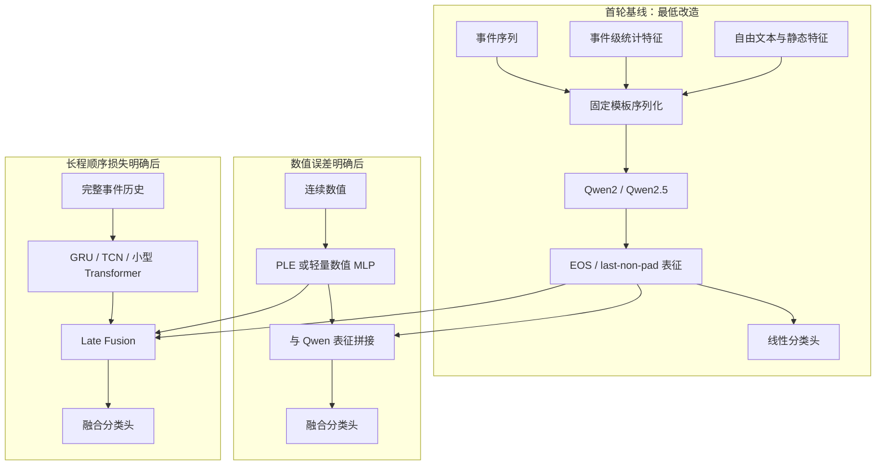
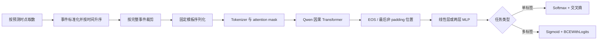
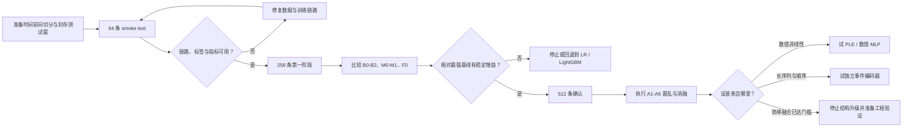

# Qwen 事件序列分类：架构与最小 PoC 方案

> **核心判断**
>
> 1. **任务建模先守住时间边界**：事件顺序、事件级统计和文本必须以预测时点为界共同构造。
> 2. **首轮采用全量文本序列化**：Qwen 原生分类头足以验证语义与顺序是否带来增益。
> 3. **训练从末位置读出与 LoRA 起步**：先控制改造面，再比较均值池化和生成式分类。
> 4. **PoC 用两阶段正交消融**：64 条只检查链路，256/512 条决定继续、升级或停止。
> 5. **是否升级由误差证据决定**：数值非线性、长序列截断或跨模态交互必须先被消融证实。

## 一、任务建模：异构输入必须保真

> **本节要点**：把每个样本定义成“截止时点之前的一段事件历史”，再固定字段语义、事件边界和可用时间；模型选择晚于这一步。

### 1.1 输入、输出与证据边界

**任务合同**：输入由按时间升序排列的事件序列、每个事件对应的统计量、自由文本和样本级静态特征组成；输出是截止时点 `prediction_cutoff` 上的单标签或多标签分类。每个字段都应记录 `event_time` 与 `available_at`，只有 `available_at` 不晚于预测时点的值才能进入样本。

**官方能力**：Qwen2/Qwen2.5 是带因果注意力的 decoder-only Transformer；Qwen2 使用 RoPE、RMSNorm、SwiGLU、QKV bias 与分组查询注意力。Qwen2.5 系列官方资料给出最长 128K 级上下文，但 Qwen2.5-7B-Instruct 默认配置仍是 32,768 token，超出后要显式配置 YaRN，且静态 YaRN 可能损害短文本性能。首轮 PoC 因而不应把“模型标称上限”等同于“业务序列可无损装入” [2](https://arxiv.org/abs/2407.10671v4) [4](https://qwenlm.github.io/blog/qwen2.5/) [5](https://huggingface.co/Qwen/Qwen2.5-7B-Instruct)。

**论文证据**：LLM4ES 把事件历史写成稳定的字段头和逐事件记录，并以自回归目标适配模型；BEHRT 则显式编码事件位置、年龄和就诊边界。两条路线共同说明，事件类型、时间或间隔、会话边界不能在序列化时被抹平 [7](https://arxiv.org/abs/2508.05688v2) [12](https://arxiv.org/abs/1907.09538)。

**工程建议**：首版固定一套无自然语言润色的模板。每条事件独占一行，字段顺序固定；自由文本做基础清洗但保留否定、数量和时间表达；统计量同时带字段名、单位、缺失标志。这样的模板便于重放、消融和定位错误，也避免额外生成模型遗漏或改写字段。TabLLM 的对照实验同样发现，少量监督样本下简单模板通常不逊于生成式序列化 [19](https://arxiv.org/abs/2210.10723)。

*单样本序列化模板：*

```text
[PREDICT_AT] 2026-08-31T23:59:59Z
[STATIC] region=华东 | account_age_days=420 | stat_30d_cnt=18 | stat_30d_amount_z=1.24 | amount_missing=0
[EVENTS_OLD_TO_NEW]
[+0000d] type=注册 | channel=自然流量 | text=首次注册 | gap_h=NA | amount_z=NA | amount_missing=1
[+0388d] type=支付 | channel=应用内 | text=购买月度套餐 | gap_h=36 | amount_z=0.73 | amount_missing=0
[+0419d] type=退款申请 | channel=客服 | text=反馈重复扣费 | gap_h=744 | amount_z=1.91 | amount_missing=0
[END_OF_HISTORY]
[CLASSIFY]
```

### 1.2 数据切分与泄漏约束

默认切分要复现部署时的信息方向。先确定预测时点与标签观察窗，再切分，最后只在各分区内部构造滑窗；若先生成重叠窗口再随机切分，相邻样本和未来统计会穿过边界，离线结果将被系统性高估 [22](https://arxiv.org/abs/2512.06932v1)。

| 环节 | 最小配置 | 执行规则 | 阻断条件 |
|---|---|---|---|
| 样本定义 | 实体×预测时点 | 特征截止于预测时点；标签来自其后的固定观察窗 | 标签回填字段进入特征 |
| 主切分 | 时间 60% / 20% / 20% | 训练最早、验证居中、测试最新；测试集一次封存 | 随机拆分时间序列 |
| 隔离带 | 至少等于标签窗 | 训练尾部与验证、测试起点间设置 purge gap | 窗口或聚合期跨越边界 |
| 实体策略 | 按部署对象预注册 | 新实体预测用 group 隔离；存量实体预测允许同实体前向出现，但窗口不得重叠 | 未说明目标便混用两种口径 |
| 预处理 | 仅训练集拟合 | 归一化、插补、分桶、类别权重和校准参数全部锁定 | 全量统计参与拟合 |

*表 1：数据切分先于构窗和预处理；时间方向与实体隔离按部署目标确定（依据 [26](https://scikit-learn.org/stable/modules/generated/sklearn.model_selection.TimeSeriesSplit.html)、[27](https://scikit-learn.org/stable/modules/generated/sklearn.model_selection.GroupKFold.html)）*

若任务尚未明确面向存量实体还是新实体，工程上采用更严格的“时间后移测试 + 实体隔离测试”双报告口径。前者衡量历时漂移，后者衡量身份记忆风险；两者不能合成一个平均分。

---

## 二、候选架构：文本化适合首轮验证

> **本节要点**：先把所有可用信息写成稳定文本，让 Qwen 与树模型在同一批样本上竞争；只有数值或长程顺序的损失被定位后，才增加专用支路。

### 2.1 纯文本序列化基线

**官方能力**：Transformers 的 Qwen2 实现提供 `Qwen2ForSequenceClassification`。它先对每个 token 的隐藏状态做线性打分，再读取每行最后一个非 padding token；单标签、多标签和回归分别使用交叉熵、BCEWithLogits 与 MSE [6](https://raw.githubusercontent.com/huggingface/transformers/v4.44.2/src/transformers/models/qwen2/modeling_qwen2.py)。这给出了最低改造成本的分类入口。

**工程建议**：在每条序列末尾追加稳定的 EOS 或汇聚标记，正确设置 `pad_token_id` 与 attention mask，并以 last-non-pad 表征接线性分类头。首轮同时保留 mean pooling 对照，因为末位置能看到完整前缀，却可能偏向最近事件；均值池化覆盖全序列，但因果掩码下早期 token 没见过未来内容 [8](https://arxiv.org/abs/2507.23386v3)。

数值先采用固定单位、训练集统计量归一化、固定小数精度和显式缺失标志。通用 tokenizer 并不天然理解数值连续性，原始 Qwen 还会逐位切分数字；因此这一方案只负责验证“数值以文本出现是否已经够用”，不能被解释为精确保真的数值建模 [9](https://arxiv.org/abs/2310.02989v2)。

### 2.2 数值投影与混合融合



*图 1：首轮共用文本主干，数值支路和事件编码器按证据逐层增加（来源：[6](https://raw.githubusercontent.com/huggingface/transformers/v4.44.2/src/transformers/models/qwen2/modeling_qwen2.py)、[7](https://arxiv.org/abs/2508.05688v2)、[10](https://arxiv.org/abs/2203.05556v4)）*

连续数值若成为主要误差来源，可以把每个标量映射为专用向量，再与文本表征拼接。分段线性编码（piecewise-linear encoding，PLE）在桶边界之间保持连续与有序，比普通分桶少丢一层桶内信息；周期数值表示在部分表格任务上更强，但实现与调参成本也更高 [10](https://arxiv.org/abs/2203.05556v4)。

文本与表格的深融合有论文支持，但证据具有场景边界。TTT 使用双流与跨模态注意力；一项临床多模态研究中，concat 加 cross-attention 的九任务平均 AUROC 为 0.845，高于纯时间序列 0.801、纯文本 0.821 和晚期加权融合 0.813。该结果来自医疗数据，不能直接当作本任务的收益承诺 [16](https://aclanthology.org/2024.findings-acl.87/) [17](https://arxiv.org/abs/2403.04012v1)。

### 2.3 三类方案的取舍

| 维度 | 全量文本化 | 数值投影 | 双塔 / 旁路融合 |
|---|---|---|---|
| 改造范围 | 原生 tokenizer 与分类头 | 新增数值编码和投影层 | 新增独立特征管线、融合头与服务链路 |
| 数值保真 | 较弱，受切词与精度影响 | 较强，可连续保序 | 取决于数值支路设计 |
| 长序列成本 | 字段重复导致 token 增长 | 数值可压缩，但事件文本仍长 | 可让专用事件塔压缩历史 |
| 可解释性 | 模板和字段消融直观 | 可检查数值区间响应 | 需分支置乱和交互消融 |
| 首轮结论 | **推荐**：最低成本验证信息增益 | 数值误差明确后再加 | 单支路互补性明确后再加 |

*表 2：三类架构由低改造到高改造递进；复杂方案均需由消融触发。*

这项判断并不预设 Qwen 会胜出。公开表格分类研究中，语言模型没有稳定超过 XGBoost、LightGBM 等专用模型；FT-Transformer 的系统比较也没有给出跨数据集的普适赢家 [11](https://arxiv.org/abs/2406.13846v1) [15](https://arxiv.org/abs/2106.11959)。因此 GBDT 是必须击败或证明互补的基线。

---

## 三、训练机制：末位置读出即可起跑

> **本节要点**：训练链路只保留一个可归因变化，即 Qwen 表征加分类头；参数高效微调、类别权重和校准分别验证，不一次叠加。

### 3.1 序列构造与分类头



*图 2：事件标准化、完整事件裁剪、Qwen 表征和分类损失构成最小训练链路（依据 [6](https://raw.githubusercontent.com/huggingface/transformers/v4.44.2/src/transformers/models/qwen2/modeling_qwen2.py)、[13](https://arxiv.org/abs/2512.12677v1)、[14](https://github.com/microsoft/LoRA/blob/DeBERTa/README.md)）*

裁剪必须以完整事件为原子，默认删除最早的完整事件并保留最近历史；同时把被裁事件数量、最早保留时间和历史累计摘要写入头部。若在一个事件的字段中间硬截断，模型会看到现实中不存在的残缺记录。

单标签任务使用 softmax 加交叉熵，多标签任务使用每类独立 sigmoid 加 BCEWithLogits。生成式分类只作为对照：它复用因果语言模型接口，却增加标签解析、非法输出和逐 token 解码成本。专利文本实验曾观察到末 token 分类头优于生成标签，但这一证据尚未覆盖业务事件序列 [13](https://arxiv.org/abs/2512.12677v1)。

### 3.2 LoRA、不均衡与校准

LoRA 冻结主干权重，在注意力投影中加入低秩可训练矩阵；最小配置只训练 `q_proj`、`k_proj`、`v_proj`、`o_proj` 和分类头。全量微调、加入前馈网络投影以及更高 rank 都属于后续消融，不能默认与 LoRA 等价 [14](https://github.com/microsoft/LoRA/blob/DeBERTa/README.md)。

类别不均衡先用训练集类别权重或加权 BCE，阈值只在验证集选择。Focal loss 可把训练权重移向困难样本，但它并非 proper loss，分类改善不保证概率可信；若启用 focal loss，仍需在独立校准集上报告期望校准误差（ECE）、Brier 分数或负对数似然 [18](https://arxiv.org/abs/2408.11598v1)。

---

## 四、快速验证：两阶段消融决定投入

> **本节要点**：第一阶段回答“新增模态有没有信息”，第二阶段回答“损失发生在哪里”；没有正交对照的高分不能支持架构升级。

### 4.1 最小可运行实验



*图 3：64 条跑通链路，256/512 条用学习曲线与置乱消融决定继续或停止（依据 [19](https://arxiv.org/abs/2210.10723)、[20](https://scikit-learn.org/stable/modules/learning_curve.html)、[21](https://scikit-learn.org/stable/modules/permutation_importance.html)）*

64/256/512 是工程化 PoC 阶梯，不是通用统计下限。TabLLM 在 0 到 512 shots 上用 5 个随机种子测量样本效率；64 条适合发现链路错误，256 条可做第一次 go/no-go，512 条用于确认增益没有随样本增加而消失 [19](https://arxiv.org/abs/2210.10723)。测试窗保持自然类别比例，若某折没有正类或正类过少，应扩大时间窗，不能改用随机切分补数。

*最小 PoC 实验合同；模型尺寸与显存为工程默认，需按实际资源确认：*

```yaml
task:
  type: binary_classification
  entity_key: entity_id
  prediction_cutoff: event_time
  label_horizon_days: 7

data:
  shots: [64, 256, 512]
  split: forward_time_60_20_20
  purge_gap_days: 7
  fit_preprocess_on: train_only
  event_order: oldest_to_newest
  max_events: 64
  truncate: drop_oldest_whole_events
  missing_value: explicit_token_and_indicator

model:
  name: Qwen/Qwen2.5-1.5B-Instruct
  class: AutoModelForSequenceClassification
  max_length: 2048
  pooling: last_non_pad_with_eos
  load_in_4bit: true
  lora:
    rank: 16
    alpha: 32
    dropout: 0.05
    targets: [q_proj, k_proj, v_proj, o_proj]

train:
  epochs_max: 15
  batch_size: 8
  gradient_accumulation: 4
  learning_rate: 0.0002
  weight_decay: 0.01
  warmup_ratio: 0.05
  early_stop_patience: 3
  seeds: [13, 37, 73, 101, 149]
  select_metric: average_precision

report:
  metrics: [average_precision, roc_auc, balanced_accuracy, macro_f1, brier]
  threshold: tune_on_validation_only
  uncertainty: paired_95pct_ci
  slices: [sequence_length, positive_rate, missingness, time_window]
```

**资源假设**：结构化 LR 与 LightGBM 在 CPU 上运行；Qwen2.5-1.5B 使用单张支持 4-bit 权重加载的 GPU。显存、吞吐和时延不从论文外推，必须记录实际硬件、库版本、峰值显存、训练分钟数与单样本 P50/P95 延迟。若当前环境没有可用 GPU，可先冻结 Qwen 表征，只训练分类头和 late-fusion 层；该结果仅判断表示互补性，不代表端到端微调上限。

### 4.2 基线、消融、指标与门槛

| 编号 | 实验 | 输入或变化 | 回答的问题 |
|---|---|---|---|
| B0 | Dummy | 按训练集先验或多数类预测 | 任务是否被基率“虚高”掩盖 |
| B1 | 正则化 LR | 样本级统计、最近事件和频次摘要 | 线性结构化信号有多强 |
| B2 | LightGBM | 与 B1 相同特征和调参预算 | 非线性结构化强基线 |
| M0 | Qwen 文本 | 事件类型、顺序与文本；移除统计量 | 语义与顺序的独立增益 |
| M1 | Qwen 全文本 | 事件、统计量与文本统一序列化 | 最低成本完整方案 |
| F0 | 简单融合 | M0 表征拼接 B2 特征，经两层 MLP 分类 | 两类信息是否互补 |
| A1 | 顺序置乱 | 测试集内置乱事件顺序，内容不变 | 模型是否真正使用时间顺序 |
| A2 | 数值破坏 | 按列置乱统计量，保持边际分布 | 数值模态是否提供增量 |
| A3 | 文本移除 | 移除自由文本，只留事件类型与统计 | 预训练语义是否有效 |
| A4 | 读出对照 | last-non-pad、mean pooling、生成标签 | 收益是否来自分类读出 |
| A5 | 长度对照 | 最近 16/32/64 条与时间窗裁剪 | 长历史是否值得额外成本 |

*表 3：第一阶段先比较 B0–F0，第二阶段用 A1–A5 定位信息来源。*

主指标用 PR-AUC，即平均精确率（Average Precision，AP）；它对少数正类更敏感。辅助报告 ROC-AUC、balanced accuracy、macro-F1，以及业务约束下的 recall@固定 precision 或 precision@固定 recall [23](https://scikit-learn.org/stable/modules/generated/sklearn.metrics.average_precision_score.html) [24](https://scikit-learn.org/stable/modules/generated/sklearn.metrics.balanced_accuracy_score.html)。概率参与排序或资源分配时，再报告 Brier、log loss 与校准曲线；校准器只使用独立验证数据，小样本优先 sigmoid，isotonic 在校准样本不足约 1,000 条时更易过拟合 [25](https://scikit-learn.org/stable/modules/calibration.html)。

| 决策 | 预注册门槛 | 解释与动作 |
|---|---|---|
| **继续** | F0 或 M1 相对最强 B1/B2 的测试 PR-AUC 绝对提升至少 0.02，配对 95% CI 下界大于 0 | 核心业务点 precision/recall 不下降，Brier 恶化不超过 0.01，成本在预算内；进入 512 条确认 |
| 升级数值支路 | A2 置乱导致稳定下降，错误集中在阈值、长尾或非单调区间，M1 仍落后 B2 | 先试 PLE 或轻量数值 MLP，再比较 concat；暂不上 cross-attention |
| 升级事件编码器 | 截断率高，A1 置乱显著伤害 AP，A5 显示长历史持续增益 | 比较聚合摘要与小型 GRU/Transformer/TCN，再做 late fusion |
| **停止或回退** | 256 与 512 两档增益不为正或 CI 跨 0；置乱新增模态后性能不降 | 保留 LightGBM/LR；检查标签噪声、泄漏和业务可分性，不再增加融合复杂度 |

*表 4：0.02 AP、0.01 Brier 与连续两档规则是工程决策阈值，并非论文共识；上线前应换算为业务净收益 [29](https://www.bmj.com/content/386/bmj-2023-078276)。*

所有模型使用同一批样本、时间窗、随机种子和调参预算。每个结果报告 5 seeds 均值、标准差及对同一测试样本的配对置信区间；早停监控验证集 AP，连续 3 次评估无改善即停止。XGBoost 文档给出的 10 轮只是示例，不能直接套到所有模型 [28](https://xgboost.readthedocs.io/en/stable/python/python_intro.html#early-stopping)。

---

## 五、能力边界：长度、数值与泄漏决定上限

> **本节要点**：模型容量不是首要风险。更常见的失败来自完整事件被截断、数值被错误离散化，以及预测时点之后的信息进入训练。

### 5.1 主要失效模式

| 上下文 | 数值精度 | 泄漏与漂移 |
|---|---|---|
| 全注意力成本随长度平方增长。按完整事件裁剪，并分长度桶报告 AP。 | 字符串切词、分桶和单位变化会改变表示。精度、token 成本与归纳偏置需联合评测。 | 结果回填、全量预处理和同期外生冲击都会制造虚假提升。上线后要按时间监测。 |

长序列应比较最近 N 条、最近 T 天、近期窗口加历史摘要和分层窗口。若目标由早期稀有事件决定，单纯保留最近事件会系统性漏信号；若目标紧邻序列末端，保留近期历史通常更符合因果可用性。结论必须按序列长度分桶，而非只报总体平均。

数值编码没有跨任务统一赢家。一项事件序列研究发现，数值字符串、float32 字节、日历 token、线性/对数分桶对下一事件时间的影响依数据分布而变；偏斜长尾更偏好对数编码，混合周期数据又可能更适合日历 token [30](https://arxiv.org/abs/2512.13618v3)。这属于论文证据，迁移到目标数据仍需 A2 和区间误差分析确认。

缺失值不能统一填 0。最低实现是“训练集插补值 + 缺失指示 + 距上次观测时间”；同时要模拟随机缺失、流程相关缺失和整模态缺失。缺失指示可能成为业务流程捷径，流程变化后需重新验证。

### 5.2 扩展条件与备选方案

- **数值投影**：仅在数值置乱显著伤害测试 AP、误差集中于连续区间且 GBDT 仍领先时启用；第一版使用 PLE 或小型 MLP。
- **独立事件编码器**：仅在截断率和顺序消融共同证明长程事件重要时启用；先试小型 GRU、TCN 或 Transformer 与 late fusion。
- **跨模态注意力**：简单拼接已证明模态互补，但交互误差仍未解决时再试；否则新增参数只扩大过拟合面。
- **非 LLM 备选**：LightGBM 达到业务门槛且 Qwen 无稳定增益时，直接采用树模型；需要文本时，可使用冻结文本向量加 GBDT/MLP。

分布漂移下，扩大历史训练窗可能引入过时样本。部署监控至少覆盖输入分布、缺失率、序列长度、置信度与标签后验；概率映射变化可重校准，特征与标签关系变化则需要重训或回滚 [31](https://arxiv.org/abs/2207.11486v1)。

---

## 六、综合判断：先证实增益再升级

> **综合判断**：建议启动小规模 PoC，但首轮只做全量文本化 Qwen、结构化强基线与简单融合。
>
> 这一结论来自三点：Qwen 已有原生末位置分类接口；事件与文本可能提供树模型未覆盖的语义和顺序信息；公开研究又没有证明语言模型稳定胜过 GBDT。因此，先用 256/512 条时间后移样本检验信息增益，证据充分后再增加数值投影或独立事件编码器。
>
> **残余风险：**
>
> 1. 目标数据的正例率、标签噪声和时间跨度未知，当前样本阶梯可能不足以形成稳定置信区间。
> 2. 模型显存、在线时延和长序列吞吐未实测，架构收益可能被服务成本抵消。

最有价值的首轮结果未必是 Qwen 获胜。如果顺序置乱、文本移除和数值置乱都不影响测试 AP，说明当前标签主要由静态统计或泄漏特征驱动；这时停止复杂化比继续调模型更合理。若新增模态的置乱重要性稳定为正，且增益跨时间窗和样本量保持，才有理由进入第二阶段。

建议把表 4 作为实验前签字的决策合同。业务方先确认 AP 提升、核心 precision/recall、时延和单位推理成本的硬门槛；实验完成后按预注册规则执行，避免看到结果后移动标准。

---

## 待验证与口径说明

> **待验证与口径说明**（当前结论用于 PoC 决策，不作上线承诺）：
>
> - 目标任务的标签定义、正例率、实体数量与时间跨度尚未提供；64/256/512 需按每个测试窗的正例数调整。
> - Qwen2.5 没有单独的完整通用技术报告；架构描述来自官方博客、模型卡及 Qwen2 的 Transformers 实现 [4](https://qwenlm.github.io/blog/qwen2.5/) [6](https://raw.githubusercontent.com/huggingface/transformers/v4.44.2/src/transformers/models/qwen2/modeling_qwen2.py)。
> - 末位置分类优于生成式分类的直接证据主要来自专利文本预印本，尚需在目标事件数据复现 [13](https://arxiv.org/abs/2512.12677v1)。
> - 跨模态注意力优于简单拼接的较强证据来自临床场景，不能替代本任务消融 [17](https://arxiv.org/abs/2403.04012v1)。
> - 0.02 AP、0.01 Brier 与连续两个样本档位是工程门槛；业务方需按误报、漏报和推理成本换算净收益。
> - 本轮未展开隐私合规、特征存储、在线回填延迟和灰度回滚实现，原因是缺少目标系统约束；进入上线设计前需另行评审。

---

## 参考文献

- [1] Qwen Team, [Qwen Technical Report](https://arxiv.org/abs/2309.16609), 2023-09-28.
- [2] Qwen Team, [Qwen2 Technical Report v4](https://arxiv.org/abs/2407.10671v4), 2024-09-10.
- [3] Qwen Team, [Hello Qwen2](https://qwenlm.github.io/blog/qwen2/), 2024-06-07.
- [4] Qwen Team, [Qwen2.5: A Party of Foundation Models](https://qwenlm.github.io/blog/qwen2.5/), 2024-09-19.
- [5] Qwen Team, [Qwen2.5-7B-Instruct Model Card](https://huggingface.co/Qwen/Qwen2.5-7B-Instruct), 访问于 2026-09-11.
- [6] Hugging Face, [Qwen2 sequence classification implementation](https://raw.githubusercontent.com/huggingface/transformers/v4.44.2/src/transformers/models/qwen2/modeling_qwen2.py), Transformers v4.44.2.
- [7] Sber AI 等, [LLM4ES: Large Language Models for Event Sequences](https://arxiv.org/abs/2508.05688v2), 2025-12-17.
- [8] Causal2Vec, [Causal Language Models as Versatile Embedding Models](https://arxiv.org/abs/2507.23386v3), 2026-05-02.
- [9] Golkar 等, [xVal: A Continuous Number Encoding for Large Language Models](https://arxiv.org/abs/2310.02989v2), 2024-12-15.
- [10] Gorishniy 等, [On Embeddings for Numerical Features in Tabular Deep Learning](https://arxiv.org/abs/2203.05556v4), 2023-10-26.
- [11] Fang 等, [Large Language Models for Tabular Data Classification](https://arxiv.org/abs/2406.13846v1), 2024-06-19.
- [12] Li 等, [BEHRT: Transformer for Electronic Health Records](https://arxiv.org/abs/1907.09538), 2019-07-24.
- [13] [Decoder-only LLMs for sequence classification with last-token representations](https://arxiv.org/abs/2512.12677v1), 2025-12-14.
- [14] Hu 等, [LoRA implementation and documentation](https://github.com/microsoft/LoRA/blob/DeBERTa/README.md), 持续更新.
- [15] Gorishniy 等, [Revisiting Deep Learning Models for Tabular Data](https://arxiv.org/abs/2106.11959), 2021.
- [16] [Tabular-Text Transformer](https://aclanthology.org/2024.findings-acl.87/), Findings of ACL 2024.
- [17] [Multimodal EHR prediction with temporal cross-attention](https://arxiv.org/abs/2403.04012v1), 2024-03-06.
- [18] [Focal Temperature Scaling](https://arxiv.org/abs/2408.11598v1), 2024-08-21.
- [19] Hegselmann 等, [TabLLM: Few-shot Classification of Tabular Data with Large Language Models](https://arxiv.org/abs/2210.10723), 2023.
- [20] scikit-learn, [Learning curve documentation](https://scikit-learn.org/stable/modules/learning_curve.html), 访问于 2026-09-11.
- [21] scikit-learn, [Permutation importance documentation](https://scikit-learn.org/stable/modules/permutation_importance.html), 访问于 2026-09-11.
- [22] [Leakage-aware validation for time series](https://arxiv.org/abs/2512.06932v1), 2025-12.
- [23] scikit-learn, [average_precision_score](https://scikit-learn.org/stable/modules/generated/sklearn.metrics.average_precision_score.html), 访问于 2026-09-11.
- [24] scikit-learn, [balanced_accuracy_score](https://scikit-learn.org/stable/modules/generated/sklearn.metrics.balanced_accuracy_score.html), 访问于 2026-09-11.
- [25] scikit-learn, [Probability calibration](https://scikit-learn.org/stable/modules/calibration.html), 访问于 2026-09-11.
- [26] scikit-learn, [TimeSeriesSplit](https://scikit-learn.org/stable/modules/generated/sklearn.model_selection.TimeSeriesSplit.html), 访问于 2026-09-11.
- [27] scikit-learn, [GroupKFold](https://scikit-learn.org/stable/modules/generated/sklearn.model_selection.GroupKFold.html), 访问于 2026-09-11.
- [28] XGBoost, [Early Stopping documentation](https://xgboost.readthedocs.io/en/stable/python/python_intro.html#early-stopping), 访问于 2026-09-11.
- [29] BMJ, [TRIPOD+AI reporting guideline](https://www.bmj.com/content/386/bmj-2023-078276), 2024.
- [30] [Tokenization strategies for temporal event sequences](https://arxiv.org/abs/2512.13618v3), 2026-05-11.
- [31] [Differentiable Forgetting for non-stationary time series](https://arxiv.org/abs/2207.11486v1), 2022-07-23.
