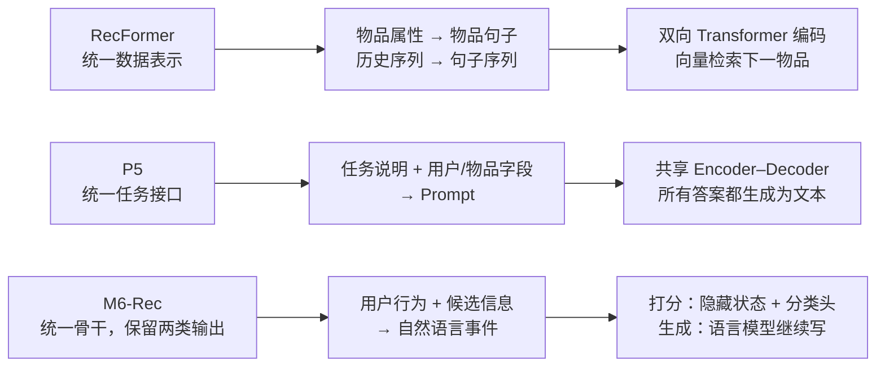
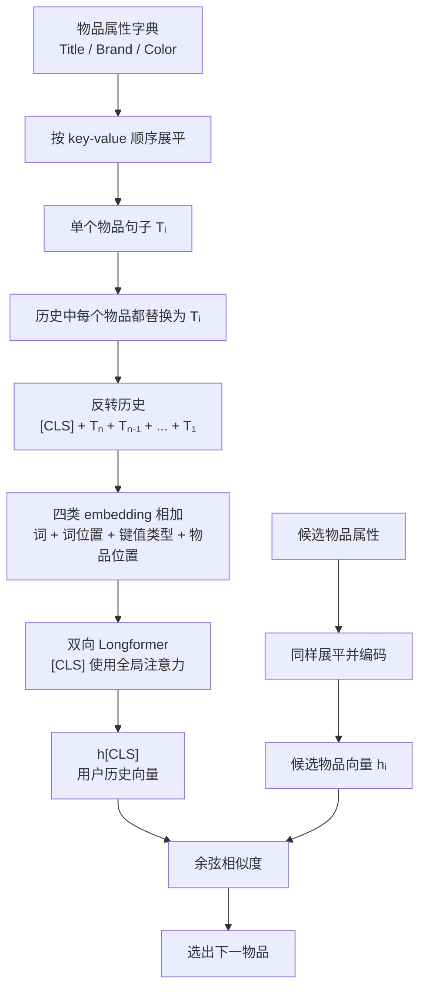
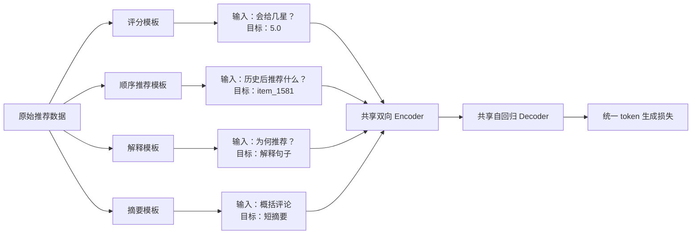
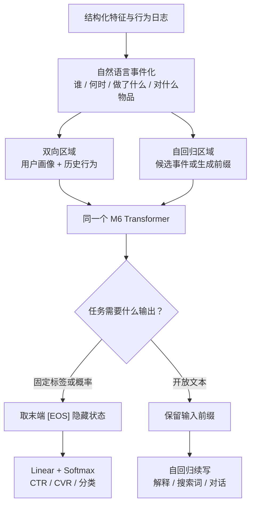
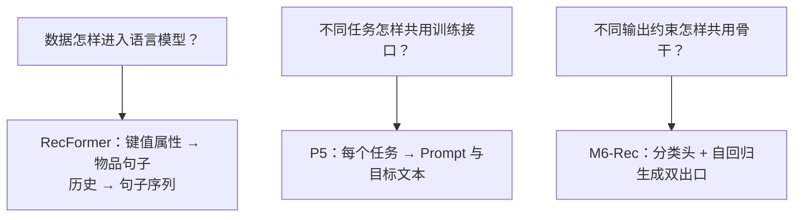
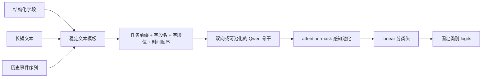

# RecFormer、P5 与 M6-Rec：推荐数据如何变成文本

> **核心区别**：RecFormer 主要统一“数据表示”，把物品属性与历史行为写成一条可编码的文本序列；P5 进一步统一“任务接口”，把评分、顺序推荐、解释、摘要都写成输入文本 → 输出文本；M6-Rec 采取混合路线，同一语言模型既可以接分类头做打分，也可以自回归生成文本。

本文基于三篇论文原文整理。为便于理解，文中的中文样例是对论文方法的等价简化，不是论文数据的逐字翻译。

## 1. 先建立一个共同视角

传统推荐模型通常把数据拆成不同形态：

- 物品是一个离散 ID，例如 `item_315`；
- 用户历史是 ID 序列，例如 `[315, 235, 822]`；
- 评分预测输出一个数值；
- 顺序推荐输出物品 ID；
- 推荐解释和评论摘要输出自然语言。

这会带来两个问题：一是输入语义分散在 ID、类别字段、标题和评论等不同载体中；二是不同任务往往需要不同模型和损失函数。

三篇论文都尝试使用语言作为“公共接口”，但统一程度不同：



可以把它们记成三句话：

1. **RecFormer：把“东西”写成句子。**
2. **P5：把“任务”写成问答。**
3. **M6-Rec：同一篇文本，既能判分，也能续写。**

---

## 2. RecFormer：物品是句子，历史是句子序列

论文：[Text Is All You Need: Learning Language Representations for Sequential Recommendation](https://arxiv.org/abs/2305.13731v2)

### 2.1 物品键值属性如何展平

假设一个物品原来是属性字典：

```text
{
  "Title": "2020 MacBook Air Laptop M1 Chip",
  "Brand": "Apple",
  "Color": "Gold"
}
```

RecFormer 不为该物品维护专属 ID embedding，而是把字典按 `键1, 值1, 键2, 值2, ...` 的顺序展开：

```text
Title 2020 MacBook Air Laptop M1 Chip Brand Apple Color Gold
```

论文把这称为一个 item sentence，即“物品句子”。形式上：

```text
Dᵢ = {(k₁,v₁), (k₂,v₂), ..., (kₘ,vₘ)}
                 ↓ flatten
Tᵢ = {k₁,v₁,k₂,v₂,...,kₘ,vₘ}
```

这里保留属性名很重要。若只拼接 `2020 MacBook Air ... Apple Gold`，模型很难稳定判断 `Apple` 是品牌，`Gold` 是颜色；加入 `Brand`、`Color` 后，字段语义直接出现在文本中。

### 2.2 历史序列如何展平

假设用户按时间先后交互过三个物品：

```text
i₁ = 鼠标
 i₂ = MacBook Air
 i₃ = iPhone 13
```

每个物品先变成自己的句子，再组成历史句子序列。RecFormer 会把历史顺序反转，让最近交互优先进入有限长度窗口：

```text
原始历史：i₁ → i₂ → i₃
模型输入：[CLS] + T₃ + T₂ + T₁
```

简化后的完整输入可能是：

```text
[CLS]
Title Apple iPhone 13 Brand Apple Color Pink
Title 2020 MacBook Air Laptop M1 Chip Brand Apple Color Gold
Title Wireless Computer Mouse Brand Amazon Basics Color Black
```

### 2.3 模型如何知道“哪个词属于哪个字段、哪个物品”

纯拼接会丢失结构，因此 RecFormer 给每个 token 叠加四种 embedding：

```text
最终 token 表示
= Token embedding
+ Token position embedding
+ Token type embedding
+ Item position embedding
```

- **Token embedding**：词本身，例如 `Apple`、`Gold`。
- **Token position embedding**：词在整条输入中的位置。
- **Token type embedding**：该 token 属于 `[CLS]`、属性键还是属性值。
- **Item position embedding**：该 token 属于最近第几个历史物品。

这相当于把被展平的二维结构重新标注回来：`Token type` 恢复“字段角色”，`Item position` 恢复“物品边界与时间位置”。



### 2.4 为什么这样能推荐下一物品

双向 Transformer 输出 `[CLS]` 的隐藏状态，作为整段历史的表示；候选物品也通过同一模型编码成向量。模型计算两者余弦相似度：

```text
score(history, item) = cosine(h_history, h_item)
```

得分最高的物品成为下一物品。RecFormer 因而不是“生成一段物品名称”，而是“用文本得到向量，再做候选检索”。它统一的是输入表示，不是所有任务的输出形式。

### 2.5 一个直觉例子

用户最近看过 `Brand Apple`、`Color Gold` 的笔记本和 `Brand Apple` 的手机。模型可以在词级注意力中发现：

- `Apple` 在不同物品中重复；
- 最近物品的 `Brand` 可能比久远物品更重要；
- 候选耳机的标题、品牌和描述与历史语义接近。

传统 ID 模型要从共现中学到这些关系；RecFormer 可以直接利用词义，对冷启动物品也能编码。

---

## 3. P5：把不同推荐任务统一为文本到文本

论文：[Recommendation as Language Processing (RLP): A Unified Pretrain, Personalized Prompt & Predict Paradigm (P5)](https://arxiv.org/abs/2203.13366v7)

### 3.1 统一的不是数据表，而是 input–target 对

P5 为每类任务设计 prompt template。模板中有用户、物品、历史、评论等占位字段；把原始数据填进去，就得到：

```text
输入文本 x → 目标文本 y
```

所有样本都进入同一个 encoder–decoder Transformer。Encoder 双向理解输入，Decoder 自回归生成目标。训练时，无论目标是 `5.0`、`item_552` 还是一句解释，都使用同一个 token 级负对数似然损失：

```text
L = -Σ log P(yⱼ | y<ⱼ, x)
```

因此，P5 所说的“统一”是：**一个模型、一个损失函数、一种 input–target 数据格式**。

### 3.2 四类任务如何改写成文本到文本

| 任务 | 输入 prompt（简化） | 目标文本 | 模型实际上在学什么 |
|---|---|---|---|
| 评分预测 | `用户 23 会给物品 7391 几星？` | `5.0` | 生成表示评分的 token |
| 顺序推荐 | `用户 15466 的购买历史：4110 → 4467 → 4468 → 4472。下一个物品是什么？` | `1581` | 生成下一个物品 ID 的 token 序列 |
| 解释生成 | `请为用户 Hong 生成该手机壳的 5 星推荐理由：...` | `它能更安全地保护手机` | 生成符合偏好和商品信息的句子 |
| 评论摘要 | `请用短句概括评论：包装已打开，取出后很快损坏……` | `到手即损坏` | 生成评论的短标题或摘要 |

论文还包含直接推荐，例如从候选列表中生成最合适的物品 ID。评分、评论和解释可以来自同一条 review 原始记录；顺序推荐则额外使用交互历史。



### 3.3 为什么“数字和物品 ID”也能作为文本生成

在 P5 中，`5.0` 和 `item_1581` 都会被 tokenizer 拆成 token。模型并不要求输出必须是自然语言句子，只要求目标能写成 token 序列。

例如：

```text
输入：What star rating ...?
输出：5.0
```

与：

```text
输入：Summarize this review ...
输出：broke immediately
```

对 Decoder 来说没有结构差异，都是“在输入条件下预测下一个目标 token”。区别只在目标序列的内容和长度。

### 3.4 P5 的代价

这种统一很灵活，但并非所有任务都因此更高效：

- 固定五分类本可一次前向得到 5 个 logits，P5 却要生成评分 token；
- 顺序推荐需要生成物品 ID，并用 beam search 得到候选列表；
- 生成结果可能出现格式错误、非法 ID 或同义表达，需要约束和映射；
- 当物品池很大时，生成式检索不一定比向量召回或分类头更便宜。

所以，P5 更适合证明“不同任务能共享语言接口”，不等于线上所有任务都应该使用生成式输出。

---

## 4. M6-Rec：同一个骨干，打分走分类头，文本走生成

论文：[M6-Rec: Generative Pretrained Language Models are Open-Ended Recommender Systems](https://arxiv.org/abs/2205.08084v2)

### 4.1 用户行为如何写成自然语言

M6-Rec 不只排列物品属性，还把时间、地点、用户画像、动作和候选物品写成事件叙述。论文给出的 CTR 样例大致是：

```text
[BOS'] 十二月，北京，天气寒冷。一名二十岁出头的男性用户，
23 分钟前搜索“冬季用品”，19 分钟前点击“男士轻量保暖夹克”，
13 分钟前点击“加大码连帽衫”…… [EOS']

[BOS] 现在向该用户推荐一双“男士防水户外徒步鞋”。
该商品过去 14 天的大盘 CTR 位于前 5%，
该用户过去两年点击过该类目 4 次。 [EOS]
```

第一段是用户侧特征和历史行为，第二段是候选物品及用户–候选交叉特征。自然语言中的主语、动作、时间和对象把原来的结构化特征串成一个可理解的事件。

### 4.2 为什么它既像 BERT，又像 GPT

M6 使用单个 Transformer，但通过 attention mask 划分两个区域：

- **双向区域**：用户画像和历史行为，区域内 token 可以互相看见，用于理解上下文；
- **自回归区域**：候选事件或待生成文本，只能看见此前 token，用于续写。

这与 P5 的独立 Encoder–Decoder 不同。M6-Rec 是一个 Transformer，通过不同注意力区域同时获得理解和生成能力。

### 4.3 判别式评分分支

做 CTR/CVR 等闭集打分时，模型读取 `[EOS]` 位置的隐藏状态，把它当作整条“用户 + 候选”样本的向量，再接线性 softmax：

```text
h_[EOS] → Linear → Softmax → P(click=0), P(click=1)
```

训练使用交叉熵。这条路线不需要模型生成“会点击”几个字，输出固定、快速，也容易校准。

### 4.4 自回归生成分支

做解释生成时，输入写到 `because` 为止：

```text
[BOS'] 用户属性和历史行为 [EOS']
[BOS] 用户购买了某商品。商品详情：……
用户喜欢它，因为
```

模型继续生成：

```text
它轻便、防水，适合用户近期关注的徒步场景。[EOS]
```

训练使用语言模型损失。个性化商品设计、搜索词生成和对话推荐也采用相同思路：先写出前缀，让模型补全目标文本。



### 4.5 M6-Rec 的关键判断

M6-Rec 没有为了“统一”而强迫所有任务都生成文本。它保留了任务需要的输出形态：

- 需要稳定概率、阈值决策和低延迟：使用分类头；
- 需要开放内容：使用自回归生成；
- 需要零样本比较候选事件：比较候选文本的平均 token 对数似然；
- 需要大规模召回：分别编码用户文本和物品文本，再做向量检索。

这比“全部文本生成”更接近工业推荐系统的实际约束。

---

## 5. 三种路线放在一起看

| 维度 | RecFormer | P5 | M6-Rec |
|---|---|---|---|
| 首要目标 | ID-free 顺序推荐 | 多任务统一 | 工业级开放任务统一 |
| 文本化对象 | 物品属性与历史序列 | 输入、任务指令和目标答案 | 用户行为、候选及生成前缀 |
| 主干 | 双向 Longformer 类编码器 | Encoder–Decoder Transformer | 带双向/自回归区域的单 Transformer |
| 评分输出 | 非核心场景 | 生成评分 token | 末端隐藏状态 + softmax |
| 顺序推荐 | 历史向量与物品向量相似度 | 生成下一物品 ID | 可按打分、生成或向量召回实现 |
| 解释/摘要 | 不负责 | 自回归文本生成 | 自回归文本生成 |
| 最值得借鉴 | 字段展开与结构 embedding | Prompt 模板和多任务数据格式 | 判别/生成双出口 |

三者不是相互替代，而是回答三个不同层次的问题：



---

## 6. 映射到分类任务：推荐的组合方式

如果目标是“借鉴 LLM for Recommendation 架构完成分类”，最实用的方案不是完整复刻任一论文，而是组合三者的长处：

1. 使用 **RecFormer 的序列化方式**：保留字段名、字段值、历史顺序和时间信息。
2. 使用 **P5 的任务前缀**：明确告诉模型当前要判断什么，但不强制生成标签文本。
3. 使用 **M6-Rec 的判别式出口**：池化隐藏状态后接线性分类头，直接输出类别 logits。



一个最小输入可以写成：

```text
[任务] 判断该样本是否属于高风险类别
[用户] 城市=北京 年龄段=20-29
[历史]
  t-3d 动作=搜索 类目=冬季用品
  t-19m 动作=点击 类目=夹克 标题=男士轻量保暖夹克
  t-13m 动作=点击 类目=卫衣 标题=加大码连帽衫
[当前对象]
  类目=户外鞋 标题=男士防水徒步鞋 大盘CTR分位=前5%
```

模型输出：

```text
logits = [低风险, 中风险, 高风险]
```

这个组合比生成 `“高风险”` 更适合普通闭集分类，因为类别空间固定，概率易于校准，延迟也更低。只有需要零样本标签迁移、开放标签或同时生成解释时，才增加生成式出口。

---

## 7. 最后用一个类比记住

把推荐系统想成处理订单的员工：

- **RecFormer** 给员工一套统一的“商品档案书写规范”，任何商品都按“标题、品牌、颜色……”写成句子，历史购买记录则装订成一册。
- **P5** 给员工一套统一的“问答工单”，评分、推荐、解释、摘要都写成问题，答案也全部填写为文本。
- **M6-Rec** 让同一个员工保留两种工作方式：选择题直接勾选概率，开放题再写完整答案。

对分类任务而言，最稳的起点是：**RecFormer 式输入 + P5 式任务说明 + M6-Rec 式分类头**。

## 参考论文

1. Li, J. et al. *Text Is All You Need: Learning Language Representations for Sequential Recommendation*. KDD 2023. [arXiv:2305.13731v2](https://arxiv.org/abs/2305.13731v2)
2. Geng, S. et al. *Recommendation as Language Processing (RLP): A Unified Pretrain, Personalized Prompt & Predict Paradigm (P5)*. RecSys 2022. [arXiv:2203.13366v7](https://arxiv.org/abs/2203.13366v7)
3. Cui, Z. et al. *M6-Rec: Generative Pretrained Language Models are Open-Ended Recommender Systems*. [arXiv:2205.08084v2](https://arxiv.org/abs/2205.08084v2)
