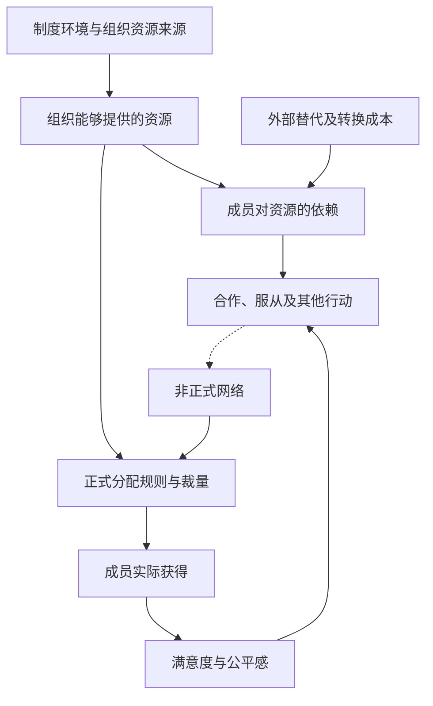

# 中国组织资源分配与人际运作研究地图

> 2026-10-31建立。入口为《中国的单位组织：资源、权力与交换》，目前已核实完整正版阅读渠道，实际研究基于公开节选及补充文献，尚未逐章读完全书。

## 先看哪一页

1. [[中国组织中的资源分配与人际运作机制]]：主要结论、解释边界和可填写的观察表。
2. [[来源-中国的单位组织-修订版与公开原始研究]]：版本渠道、七章目录、原文链接与读取范围。
3. [[资源依赖与组织权力]]：权力的关系定义，资源价值与替代来源。
4. [[单位制机制在当代组织中的适用边界]]：防止将历史经验直接推广到当代所有组织。

## 机制路径

此图是理论综合与待验证路径，箭头不是已识别的因果效应。关系与行动也可能互相影响，资源获得可能反向改变依赖和态度。

## 原书章节对应的问题

| 章节 | 研究问题 | 本次状态 |
|---|---|---|
| 第一章 | 单位为什么超出一般工作组织 | 读到序言及第一章部分 |
| 第二章 | 资源如何形成依赖与交换 | 配套原论文理论与方法前部已读，完整结果未核验 |
| 第三章 | 权力与非制度方式如何影响获得 | 配套原论文摘要及第一分页已读 |
| 第四章 | 满意度、相对剥夺与依赖怎样关联 | 由目录与配套原论文提出问题，未读完整章 |
| 第五章 | 单位类型有什么差别 | 未读完整章 |
| 第六章 | 组织与制度怎样连接和变化 | 未读完整章 |
| 第七章及附录 | 样本、编码、量表是否支持结论 | 未完成整书核验 |

配套论文不是对应书章全文的替代品；不能把论文部分阅读状态写成书章已读。

## 下一轮优先核验

- 获得完整正版正文后，核验第五、六章的类型边界及改革机制。
- 核验第七章的最终有效样本、缺失处理、变量定义和完整结果。
- 分清资源、态度与关系的时间顺序，评估反向因果与共同原因。
- 如分析具体当代组织，另收集其权限、资格标准、分配记录和复核实例。

主题的核心是组织社会学与社会分层。它可以独立存在于本 Wiki，无须强行连接到技术主题。
