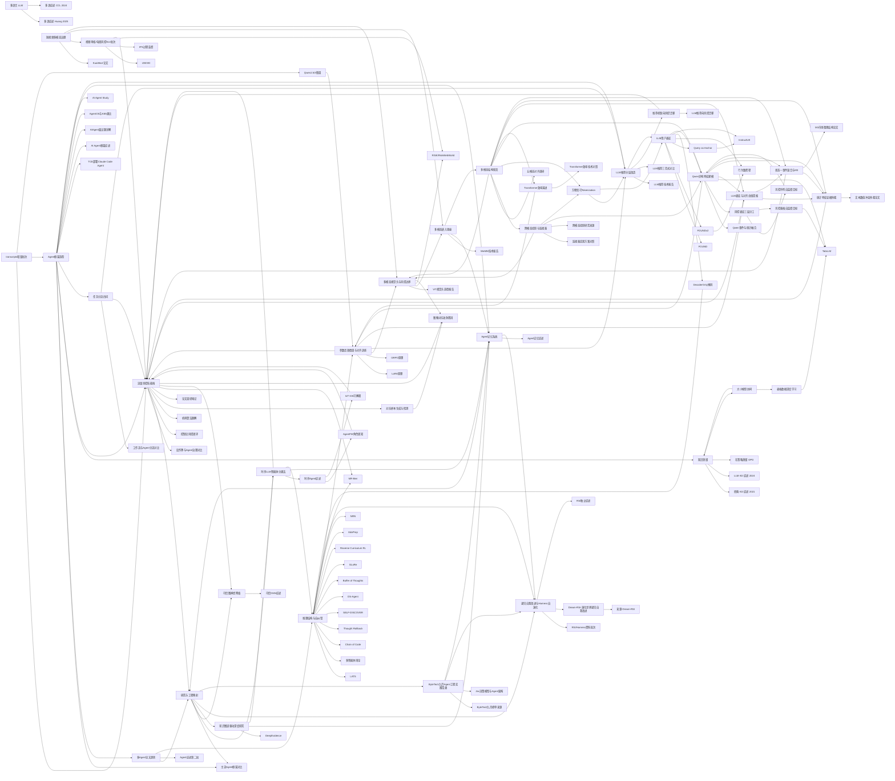

# 研究主题导航

本页用**主题地图**串起当前已摄入的综述与概念页，便于从问题域跳转。

> 新增概念入口：[[LLM表征与对齐总统简报-2026]] · [[LLM统计特征编码的证据仲裁]] · [[状态—事件混合生成与M3]]。

## 对应页面

- [[知识蒸馏]] · [[来源-知识蒸馏综述-2021-Gou]] · [[来源-大语言模型知识蒸馏综述-2024]] · [[来源-大语言模型在策略蒸馏综述]]
- [[大语言模型与多语言]] · [[来源-多语言大语言模型综述-2025-Huang]] · [[来源-大模型时代多语言研究综述-CCL-2024]]
- [[大小语言模型协同]] · [[来源-大小语言模型协同机制综述-2025]]
- [[表格数据深度学习]] · [[TabLLM]] · [[风控表格数据编码器的自监督学习目标设计]] · [[来源-风控表格编码器自监督目标公开文献调研-2026]] · [[来源-表格数据Transformer模型综述与实践]]
- [[表格建模选型决策树]] · [[表格建模路线对比-TabLLM-vs-树模型-vs-Transformer]]
- [[短视频内容审核与多模态治理]] · [[长多模态上下文的证据约束意图分类]] · [[来源-KuaiMod-VLM-短视频审核]] · [[来源-长多模态意图分类内部实践-已脱敏-2026]]
- [[Agent框架选型与工程维度]] · [[主流Agent框架对比-2026-06-20]] · [[来源-搜索归档-Agent框架-2026-06-20]]
- [[多Agent系统研究趋势与工程映射]] · [[多Agent论文方向对比-2026H1-arXiv]] · [[来源-搜索归档-多Agent-arXiv-2026-06-20]]
- [[多Agent研究与工程落地地图]] · [[来源-搜索归档-Claude-Code-Minimal-Stack-2026-06-20]]
- [[流量风控技能栈与Agent治理]] · [[传统流量反作弊与Agent流量治理对比]] · [[来源-搜索归档-流量风控skills-2026-06-20]]
- [[来源-搜索归档-Agent风控情报Watch-2026-06-21]]（定时情报批次，含平台偏移与证据分层标注）
- [[Agent任务分流：工作流与智能体边界]] · [[工作流与Agent任务分流对比-2026-06-21]] · [[来源-构建Agent的四个问题-2026-06-21]]
- [[来源-raw-transcripts增量批次-2026-06-21]]（本轮转录增量编目：Agent/风控/微调/对抗样本）
- [[来源-TCE部署ClaudeCodeAgent操作清单-2026-06-21]]（企业内网部署路径：TCE + 飞书桥接 + Claude Code）
- [[来源-Qwen2.5与Qwen3微调深度调研-2026-06-21]]（Qwen2.5 到 Qwen3 的微调方法演进）
- [[来源-基于控制论的内容风控系统全流程方案-2026-06-21]]（风控闭环控制与 PID 调阈方法）
- [[来源-AIAgent常见框架深度介绍-2026-06-21]]（单Agent/多Agent/平台协议全景与选型趋势）
- [[来源-内容风控与机审算法面试题详解-2026-06-21]]（文本-图像-视频-多模态机审方法清单）
- [[来源-AIAgent面试题详解-2026-06-21]]（面试向工程知识框架：闭环执行、记忆分层与工具治理）
- [[来源-对抗样本生成与检测调研实验-2026-06-21]]（对抗攻击家族与分层防御实验：视觉编码瓶颈诊断）
- [[来源-Agent时代的K8S与AgentOS形态设想-2026-06-21]]（以 K8S 类比解释 AgentOS 的声明式编排与运行时治理）
- [[来源-AIAgent学习与智能诊断落地路线图-2026-06-21]]（SRE 诊断场景下从学习到上线的 30 天工程化路径）
- [[来源-论文调研与对抗检测方向笔记-2026-06-21]]（小目标检测、时序聚合与对抗样本研究线索汇总）
- [[来源-经典Agent综述论文翻译第二批-2026-06-21]]（工具学习/多智能体/规划/个人Agent方向导读）

## 分节详解与跨文献对照

- [[知识蒸馏三综述分节对照]] · [[多语言双综述分节映射与对比]] · [[七篇文献体例与覆盖面对照]]

> 上述 `[[链接]]` 在 Obsidian 中解析为同名标题或别名；若未自动匹配，请从 [内容目录](../index.md) 进入。

- [[推理评测污染与捷径风险]] · [[来源-小学算术基准污染检验-GSM1k-2024]] · [[来源-Neuro-Symbolic推理捷径基准-rsbench-2024]]

- [[LLM推理结构与自纠错框架]] · [[推理框架六法对照-2026-06-22]] · [[来源-LATS-统一推理行动规划-ICML2024]] · [[来源-多智能体辩论提升事实性与推理-ICML2024]] · [[来源-Buffer-of-Thoughts-思维模板缓冲-NeurIPS2024]] · [[来源-GLoRe-全局局部联合修正-ICML2024]] · [[来源-Reverse-Curriculum-RL-逆课程推理强化-ICML2024]] · [[来源-AdaProp-自适应传播路径-KDD2024]] · [[来源-NRN-实体与数值联合推理-KDD2024]] · [[来源-MR-Ben-元推理基准-System2-NeurIPS2024]]
- [[可信图神经网络]] · [[来源-可信图神经网络综述-2022]]（从图学习视角补入“鲁棒性/可解释性/隐私/公平/问责/环境福祉”六维治理框架，并与风控/多Agent 系统治理形成跨域对照）

## 补充织入（2026-08-31）

- [[Agent记忆系统与自我演进]] · [[来源-Agent记忆综述-2026]]（Foundation Agent Memory 三维分类法：基底/认知机制/主体；记忆从被动存储到可学习策略的自我演进，并与多 Agent 协作拓扑下的记忆路由呼应）
- [[时间序列LLM智能体分类法]] · [[来源-时间序列LLM智能体综述-2026]]（问题驱动四分类 + 架构/工具/记忆三维度；时序异常检测子域：ARGOS 可解释规则 / CALM LLM-as-Judge / SAGE 专门分析器 / AgentFM 角色感知 / IoT-XAI 可解释混合，与风控可审计链路同构）
- [[多模态嵌入与检索基座]] · [[来源-WeMM多模态嵌入技术报告-2026]]（CLIP → MLLM 隐藏状态适配 → 通用多模态嵌入模型族；WeMM 两阶段训练，2B 超旧 8B、9B 登顶 MMEB-v2，与审核/记忆系统的多模态召回共享基座）
- [[来源-视频审核与电商风控GUI-Agent批次-2026]]（UNIVID 统一 VLM 审核基座 / IPS 提示内过程监督 / VideoModerator 2021 起点 / RISK 框架 + RiskWebWorld 基准，补强短视频审核演进与电商风控 GUI Agent 治理）
- [[多模态模型视觉头与风控部署边界]] · [[来源-开源多模态模型ViT视觉头与风控落地选型报告-2026]]（把视觉头能力、整模型表现与风控系统 KPI 三层拆开；补入“开放多模态模型该如何在风控里定位语义证据层与裁决边界”）
- [[来源-图像对抗攻防答辩文档-2026]] · [[对抗样本攻击原理与实践]]（把图像对抗问题进一步拆成“视觉头看不见”与“LLM 判断错”两类失效，并补入“先做对抗检测触发增强审核，再决定是否重审”的工程链路）
- [[图像对抗防御链路对照-2026-09-02]]（把 SMSP / SegFormer / 对抗检测触发器 / 重模型二审 / 最终裁决器放回统一审核链路，比较“该放哪一层、解决哪类失效、付出什么代价”）
- [[知识图谱驱动的深度研究Agent]] · [[来源-DeepEvidence-生物医学知识图谱深度研究-2026]]（BFRS/DFRS 双研究子 Agent + 证据图谱记忆 + 统一 KG 工具层 + 代码沙箱；补入“deep research 在高结构化领域如何工程化”这一跨域节点）
- [[参数高效微调与对齐训练]] · [[来源-LoRA低秩适配原理-2026]] · [[来源-GRPO分组相对策略优化原理-2026]] · [[参数高效微调与对齐训练方法对照-2026-09-03]]（把 LoRA/QLoRA、DPO、GRPO 放回同一训练栈，区分“参数怎么省”与“行为怎么对齐”）
- [[长多模态上下文的证据约束意图分类]] · [[证据约束分类的正反证据与适用边界-2026]] · [[来源-长多模态意图分类内部实践-已脱敏-2026]]（覆盖输入标准化、多模型候选、人审反馈、证据链蒸馏和过程奖励；CoT 不忠实、解释指标 Goodhart、结果监督反例与 EviState smoke 边界用于限制过强主张）
- [[递归自我改进与Harness自演化]] · [[来源-递归自我改进与Harness自演化-2026]]（把模糊目标操作化、Harness、经验整合与独立验证拆为四环；现有证据支持局部改进，不支持稳定开放式 RSI）
- [[ByteTech-2026年9月Agent工程实践聚类]] · [[来源-ByteTech-2026年9月最佳AI与Agent内容]]（将 10 篇最佳文章与 4 场最佳分享聚为决策模型、Harness/自演化、领域知识闭环和个人 AI Coding 四条主线，并保留内部统计口径与正文读取限制）
- [[Jev决策模型与Agent架构]] · [[来源-Jev内部分享与工程实践-2026]]（ByteTech 两篇内部文章与真实接口测试：有界决策、概率校准、Seed 对照、计算/规则/无意义输入边界）
- [[来源-Dream-RSI-演化世界递归自我改进-2026]]（把 discovery history 做成可回放世界，在离线"做梦"里廉价评估/优化探索策略——第三种改进基底，闭合元层 RSI；收益在递归轮内、任务内成立）
- [[来源-RSI综述-Preprints-2026]]（RSI 独立综述，未评审：机制级统一框架、自动化设计 vs 修复优化、以独立测试/预算/保留/改进器增益分层的证据协议，印证"局部可用、开放式未证"）
- [[LLM推荐系统的分层改造与评估]] · [[来源-LLM推荐技术范式与落地边界-2026]] · [[LLM推荐三种系统范式对比-2026-09-11]]（语义增强 / 受约束生成 / Agent 编排按责任分层；以候选、可靠性、成本与线上反馈共同验收）
- [[多模态结构保真与统一对齐]] · [[来源-五模态数据统一对齐技术调研-2026]]（共享接口不等于统一原始编码；以边—环—整体诊断数值、时序、空间与拓扑结构）
- [[多模态大模型跨模态投影与连接器]] · [[跨模态连接器实现方案对照-2026]] · [[来源-跨模态投影与连接器研究-2026]]（区分维度适配、token 压缩、信息选择与语义对齐；按 linear / MLP、空间压缩、查询压缩、深层融合和统一 token 路线组织正反证据）
- [[万物皆可Tokenization：统一接口、离散化与连续建模]] · [[来源-万物皆可Tokenization研究-2026]] · [[Tokenization候选工作附录-2026]]（比较固定分块、连续 latent、离散量化码、Semantic ID 与动作/结构输出词表；核心证据与宽搜候选分层维护）
- [[Transformer效率演进]] · [[Transformer效率技术对照-2026]]（2017–2026 主线：全量自注意力 → 块级稀疏（MoBA/NSA/MSA）、线性定长状态（KDA）、KV 压缩（MLA/CSA-HCA）；由视频"55 秒看完 Transformer 效率演进时间线"引出的 10 篇论文）
- [[BERT4Rec数据处理与输入张量]] · [[来源-BERT4Rec原论文与参考实现-2019]] · [[Qwen异构特征接入与事件序列建模]] · [[来源-Qwen事件序列与统计特征融合方案-2026]] · [[异构数据接入大模型的四档方案对比-2026]]（先固定离散序列与 Cloze 输入契约，再按强基线→文本化→软 token→深融合升级）
- [[事件序列编码器的自监督联合预训练]] · [[来源-序列编码器自监督联合训练内部实践-已脱敏-2026]] · [[来源-序列编码器训练合同与骨干对照内部分析-已脱敏-2026]] · [[LLM用户表征基础模型与场景适配]]（联合 InfoNCE 类对比目标与掩码恢复目标，区分梯度 smoke 与正式目标，并用控制变量比较 GRU 和 Transformer）
- [[风控表征学习中的生成机制、风险定义与表征分工]] · [[风控行为序列表征的自监督学习目标设计]] · [[风控表格数据编码器的自监督学习目标设计]]（纯自监督只学习生成结构；表征负责尽量不丢信息，风险边界由标签、规则、监管口径和代价函数定义）
- [[风控行为序列表征的自监督学习目标设计]] · [[来源-风控行为序列表征自监督目标公开文献调研-2026]] · [[事件序列编码器的自监督联合预训练]]（按在线因果、离线复用和连续时间三类用途选择目标，并区分纯自监督、领域引导和弱监督）
- [[风控表格数据编码器的自监督学习目标设计]] · [[来源-风控表格编码器自监督目标公开文献调研-2026]] · [[表格数据深度学习]]（按遮蔽重建、扰动识别、行级对比、自生成任务与跨表迁移选择目标；区分同源统计与外部表格信息）
- [[GRU单条与Batch推理的cuDNN-TF32一致性]] · [[来源-GRU单条与Batch推理一致性内部诊断-2026]] · [[Qwen3-VL事件序列编码器选型-2026]]（将跨 batch shape 一致性与运行间确定性分开验收；限定环境内，cuDNN TF32 开关解释了 GRU 首次超标）
- [[多模态行为序列与表格编码器对比-2026]] · [[来源-LUMOS多模态用户行为预测-2026]] · [[来源-FOUNDv2统一量化用户Tokenizer-2026]] · [[来源-TableGPT2表格数据多模态接入-2026]] · [[来源-MultiModalPFN多模态表格学习-2026]] · [[来源-MP4SR多模态序列推荐-2023]]（区分行为+统计、表格+图文、行为+物品内容三类编码器）
- [[LLM表征与对齐总统简报-2026]]（将表征—对齐—行动分层连接到异构输入、结构保真、参数高效对齐与风险治理；近期外部研究仅列为待核线索）
- [[LLM统计特征编码的证据仲裁]] · [[来源-文本与数值冲突下的LLM证据仲裁-2026]]（前者将统计特征的窗口、口径、来源与缺失拆成可审计冲突状态；后者以文本、数值、时效、可靠性与工具预测冲突的受控 arXiv 预印本为实验锚点，作者报告、未同行评审）
- [[状态—事件混合生成与M3]] · [[来源-M3市场微观结构状态事件生成模型-2026]]（将状态条件、事件候选与确定性回放拆开；M3 arXiv 预印本以 LOB 前缀、离散订单事件和撮合回放给出金融领域实例，作者报告、未同行评审，不能外推为通用架构结论）
- [[来源-LLM推荐向风控迁移机制与验证路径-2026]]（将离线 LLM 教师、在线校准小模型与规则/策略执行分层，避免直接迁移推荐效用和高影响动作权限）
- [[风控模型训练部署与监控生命周期]] · [[来源-风控模型安全部署与监控内部实践-已脱敏-2026]]（以统一特征执行、隔离加载、资源与性能门禁、灰度回退和绝对/相对变化告警补齐模型工程控制面）
- [[LLM用户表征基础模型与场景适配]] · [[来源-FOUND可迁移可预测用户定向基础模型-2025]] · [[来源-FOUNDv2统一量化用户Tokenizer-2026]] · [[来源-Query-as-Anchor场景自适应用户表征-2026]] · [[来源-用户行为致密律与自适应Token化-2026]] · [[来源-DecoderOnly用户表征注意力掩码-2026]] · [[来源-InstructUE指令感知用户嵌入-2025]] · [[来源-TokenMinds-预训练用户Token-2026]]（将未来对齐、量化长历史、条件化表示、decoder-only 掩码适配与共享 SID 词表的离散用户 token 接入推荐表征层，而不替代召回、排序与政策控制面）
